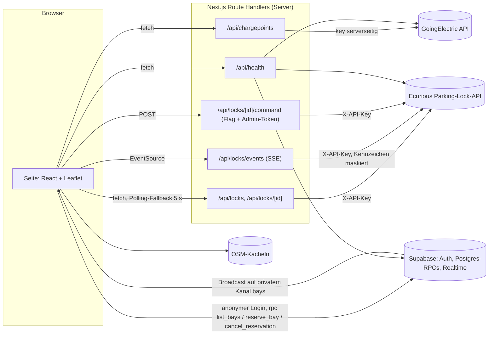

# ⚡ FLASH – Ladeplatz reservieren (Ecurious-Challenge)

Mini-Prototyp als Web-App: EV-Fahrer reservieren eine öffentliche Ladesäule, die physisch durch einen
Ecurious-Parkbügel freigehalten wird. **Stufe 1:** Alle externen APIs sind angebunden und per kurzem Check
nachweisbar erreichbar. Die UI ist bewusst noch schlicht.

Stack: Next.js 16 (App Router, Route Handlers als Backend) · TypeScript · Tailwind 4 · Leaflet/react-leaflet mit
OSM-Kacheln · Supabase (Postgres, RLS, RPC, Anonymous Auth, Realtime Broadcast) · vitest.

## Setup (5 Befehle)

```bash
npm install
cp .env.example .env.local                      # Keys eintragen, siehe Tabelle unten
npx supabase db push --db-url "<Postgres-Connection-String>"   # Migrationen inkl. Seed
npm run check:apis                              # ✅/❌ pro API
npm run dev                                     # http://localhost:3000
```

Für den Supabase-Schritt den Connection-String aus dem Dashboard nehmen (*Connect → Session pooler*).
Alternativ beide Dateien aus `supabase/migrations/` der Reihe nach im SQL-Editor ausführen.
Im Dashboard außerdem **Authentication → Sign In / Providers → „Allow anonymous sign-ins“** einschalten.

Node ≥ 20.19 (empfohlen 22). Ohne Hardware: `ECURIOUS_MOCK=true` setzen.

## Welche Keys wohin

| Variable | Wo | Öffentlich? | Zweck |
| --- | --- | --- | --- |
| `NEXT_PUBLIC_SUPABASE_URL` | `.env.local` / Vercel | ja (Browser) | Supabase-Projekt-URL |
| `NEXT_PUBLIC_SUPABASE_PUBLISHABLE_KEY` | `.env.local` / Vercel | ja (Browser) | Publishable Key (`sb_publishable_…`), Zugriff nur über RLS/RPCs |
| `GOINGELECTRIC_API_KEY` | `.env.local` / Vercel | **nein** | nur in `/api/chargepoints` und den Checks |
| `ECURIOUS_BASE_URL` | `.env.local` / Vercel | **nein** | Base-URL der Parking-Lock-API (von Ecurious) |
| `ECURIOUS_API_KEY` | `.env.local` / Vercel | **nein** | Header `X-API-Key`, nie als Query-Parameter |
| `ECURIOUS_LOCK_ID` | `.env.local` / Vercel | nein | optional: Lock des Demo-Stellplatzes (sonst erster Lock aus `GET /api/v1/locks`) |
| `ECURIOUS_MOCK` | `.env.local` / Vercel | nein | `true` = feste Beispieldaten (ein Lock, vacant, raised) |
| `ECURIOUS_COMMANDS_ENABLED` | `.env.local` / Vercel | nein | `false` (Standard) = keine Hardware-Befehle möglich |
| `FLASH_ADMIN_TOKEN` | `.env.local` / Vercel | **nein** | Pflicht für Befehle; die Admin-Buttons fragen danach |

Server-Keys tragen nie das Präfix `NEXT_PUBLIC_`. `.env.local` ist per `.gitignore` ausgeschlossen, nur
`.env.example` (ohne Werte) wird committet. Auf Vercel dieselben Variablen unter *Settings → Environment Variables*
eintragen.

## Architektur



| Route | Was |
| --- | --- |
| `GET /api/health` | dieselben Checks wie `check:apis` als JSON (30 s im Speicher gecacht, SSE nur „Stream öffnet“) |
| `GET /api/chargepoints?sw_lat&sw_lng&ne_lat&ne_lng[&plugs&min_power]` | reicht GoingElectric durch, normalisiert, keine Speicherung, `Cache-Control: private, max-age=60` |
| `GET /api/locks` | Locks + `defaultLockId` (aus `ECURIOUS_LOCK_ID` bzw. erster Lock) |
| `GET /api/locks/[id]` | Lock + letztes Kennzeichen (maskiert) |
| `GET /api/locks/events` | Ecurious-SSE an den Browser, jedes Kennzeichen maskiert, Heartbeat alle 15 s |
| `POST /api/locks/[id]/command` | `{action: lock\|unlock\|keep-state\|whitelist}`, nur mit `ECURIOUS_COMMANDS_ENABLED=true` + Header `x-admin-token`; `lock` nur bei frischem `carPresence=vacant` |

**Datenschutz:** Kennzeichen werden serverseitig maskiert (`M-AB 1234` → `M-AB***`), bevor sie REST-Antworten, SSE oder
Logs erreichen. Statusangaben mit `lastSeenAt` älter als 60 s erscheinen als „unbekannt“.

**Supabase:** `bays` und `reservations` haben RLS ohne Policies, Clients dürfen nur `list_bays()`, `reserve_bay(bay_id,
minutes, request_id)` und `cancel_reservation(id)` ausführen (nur Rolle `authenticated`, also auch anonyme Gäste).
`reserve_bay` sperrt die Stellplatz-Zeile (`for update`), setzt abgelaufene Holds auf `expired`, ist über `request_id`
idempotent und rechnet die Ablaufzeit mit `now()` der DB. Ein partieller Unique-Index erzwingt höchstens einen `held`
pro Stellplatz. Ein Trigger sendet jede Änderung per `realtime.send` (Broadcast from Database) auf den privaten Kanal
`bays`, ohne `user_id` im Payload; andere Tabs laden daraufhin `list_bays()` neu. Der Countdown rechnet mit der DB-Uhr
(`server_now`), nicht mit der Browser-Uhr.

## Checks und Tests

```bash
npm run check:apis   # GoingElectric, Supabase (anonym + list_bays), Ecurious /locks, plate/latest, 5 s SSE
npm test             # vitest: GE-Normalisierung, Kennzeichen-Maskierung, SSE-Maskierung, Datenalter, Supabase-Race
```

- `check:apis` ist nur lesend, alle Checks laufen parallel mit je 5 s Timeout (gesamt ≈ 5 s). Es prüft immer die
  echte Ecurious-API, auch wenn `ECURIOUS_MOCK=true` für die Webseite gesetzt ist.
- `tests/reserve-race.test.ts` läuft gegen die echte Supabase-DB: zwei anonyme Gäste reservieren gleichzeitig, genau
  einer gewinnt; danach Idempotenz, Fremd-Storno und Aufräumen. Ohne Supabase-Keys wird er übersprungen, ebenso wenn
  der Stellplatz gerade reserviert ist.

## Doku-Abgleich (Stand 24.10.2026)

- **Supabase:** gegen die offizielle Doku (Repo `supabase/supabase`, `apps/docs`) geprüft: Broadcast from Database
  (`realtime.send`, private Kanäle, RLS-Policy auf `realtime.messages`), Anonymous Sign-ins (Rolle `authenticated`,
  Claim `is_anonymous`, IP-Limit 30/h, CAPTCHA empfohlen).
- **Next.js 16.4:** gegen die mitgelieferte Doku in `node_modules/next/dist/docs` (Route Handlers mit Cache Components,
  `connection()`).
- **GoingElectric:** Die offizielle Seite (goingelectric.de/stromtankstellen/api) war aus der Build-Umgebung nicht
  erreichbar. Parameter und Antwortformat stammen aus der API-Anleitung des Projekts und dem Open-Source-Client EVMap
  (`ev-map/EVMap`): `chargelocations[]`, `ge_id`, `coordinates`, `chargepoints[]`, `false` statt `null`,
  protokoll-relative `url`, `startkey` fürs Blättern. **Offen:** Nutzungsbedingungen (serverseitiges Durchreichen,
  Caching, Pflicht-Attribution) noch gegenlesen. Falls ein Server-Proxy nicht erlaubt ist: Aufruf in den Browser
  verlegen (`fetch` direkt aus `components/FlashApp.tsx`). Dann ist der Key im Browser sichtbar.
- **Ecurious:** keine öffentliche Doku gefunden. Grundlage sind die API-Anleitung der Challenge (Endpunkte,
  Antwortformate, SSE-Events `status_change`, `vehicle_presence`, `photo_captured`, `alarm`) und ein lokaler Test gegen
  einen Fake-Server in genau diesem Format.

## Bekannte Grenzen

- **Live nicht verifiziert:** In der Build-Umgebung waren GoingElectric, Ecurious und Supabase per Netzwerk-Policy
  gesperrt, und es gab keine Keys. Alles wurde gegen lokale Nachbauten getestet: Fake-Ecurious im dokumentierten
  Format, Postgres 16 mit nachgebautem `auth`/`realtime`-Schema inklusive echtem Parallel-Test, abgefangene
  Supabase-Antworten im Browser. Erster Schritt mit echten Keys: `npm run check:apis` und `npm test`.
- **Lock-Zuordnung:** Der Seed legt den Stellplatz ohne `lock_id` an, weil SQL-Migrationen keine Umgebungsvariablen
  lesen. Der Server ordnet dann `ECURIOUS_LOCK_ID` (oder den ersten Lock) zu. Fest verknüpfen per SQL:
  `update public.bays set lock_id = '<id>'` (die ID zeigt `check:apis`).
- **Reservierung und Bügel sind noch nicht gekoppelt:** Reservieren bewegt keine Hardware (siehe Roadmap).
- **SSE auf Vercel:** Funktionen haben eine Maximallaufzeit. Danach endet der Stream und `EventSource` verbindet neu;
  dazwischen pollt die Seite alle 5 s. Mock-SSE-Events gibt es nur innerhalb eines Server-Prozesses (lokal).
- **Abgelaufene Holds** werden erst beim nächsten `reserve_bay` auf `expired` gesetzt. `list_bays()` zeigt sie aber
  sofort als frei an, und der Browser lädt beim Countdown-Ende neu.
- **Realtime-Partition:** Laut Supabase-Doku legt erst ein verbundener Client die Tagespartition von
  `realtime.messages` an. Vorher scheitert der Broadcast mit einer Warnung; die Reservierung selbst klappt trotzdem.
- **Anonyme User sammeln sich:** pro Browser einer, pro Testlauf zwei, pro Server-Instanz einer für `/api/health`.
  Aufräumen z. B. per `delete from auth.users where is_anonymous and created_at < now() - interval '30 days';`.
  Vor einem öffentlichen Einsatz CAPTCHA/Turnstile aktivieren (Supabase-Empfehlung).
- **Admin-Schutz** ist nur ein gemeinsames Token. Befehle sind standardmäßig aus.
- **OSM-Kacheln** direkt von tile.openstreetmap.org sind nur für den Prototyp gedacht (Tile Usage Policy); für
  echten Betrieb einen eigenen Kachel-Anbieter nehmen.
- Kein Stecker-/Leistungsfilter in der UI (die Route unterstützt `plugs` und `min_power`). Der Kartenausschnitt ist
  auf 0,5° begrenzt, ohne Blättern über `startkey`.

## Roadmap (noch nicht gebaut)

1. **Kompletter Zyklus:** reservieren → Ankunft per Kennzeichen (Whitelist am Bügel, Kamera senkt automatisch) →
   laden → freigeben (Bügel hoch, Whitelist leeren, Reservierung `completed`).
2. **No-Show-Ablauf:** Hold läuft ab → Whitelist entfernen, Platz wieder freigeben, ggf. Sperrfrist für den Gast.
3. **Blockierter Stellplatz:** `vehicle_presence=occupied` ohne passendes Kennzeichen erkennen, Reservierung pausieren
   bzw. umbuchen, Betreiber benachrichtigen (`alarm`-Events).
4. Gäste-Accounts in feste Accounts überführen, CAPTCHA, Admin-Rollen statt Token.
5. Später ggf. mobile App (gleiche Supabase-RPCs und Route Handlers).
