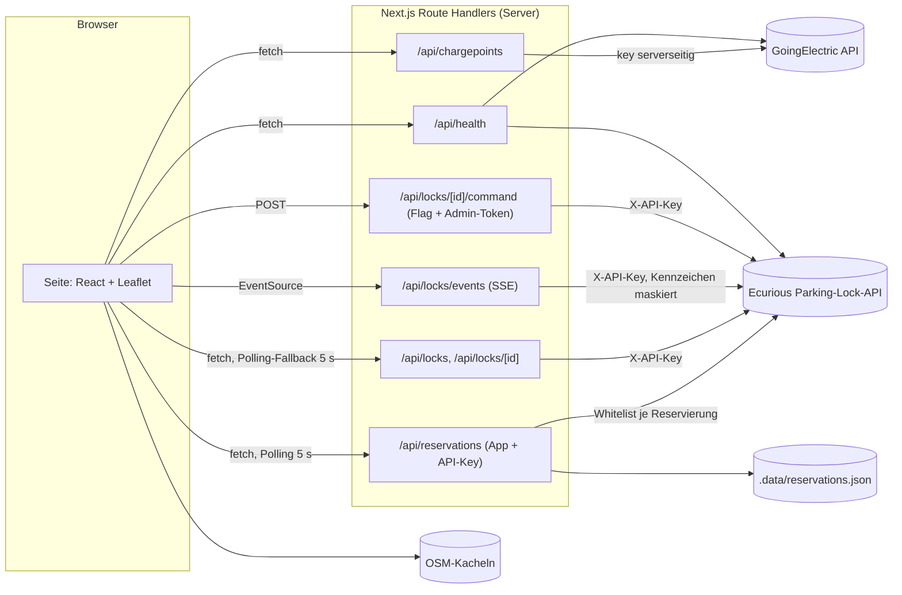

# ⚡ FLASH – Ladeplatz reservieren (Ecurious-Challenge)

Mini-Prototyp als Web-App: EV-Fahrer reservieren eine öffentliche Ladesäule, die physisch durch einen
Ecurious-Parkbügel freigehalten wird. **Stufe 1:** Alle externen APIs sind angebunden und per kurzem Check
nachweisbar erreichbar. Die UI ist bewusst noch schlicht.

Stack: Next.js 16 (App Router, Route Handlers als Backend) · TypeScript · Tailwind 4 · Leaflet/react-leaflet mit
OSM-Kacheln · vitest. Reservierungen liegen serverseitig in `.data/reservations.json` (keine externe Datenbank).

## Setup (4 Befehle)

```bash
npm install
cp .env.example .env.local                      # Keys eintragen, siehe Tabelle unten
npm run check:apis                              # ✅/❌ pro API
npm run dev                                     # http://localhost:3000
```

Node ≥ 20.19 (empfohlen 22). Ohne Hardware: `ECURIOUS_MOCK=true` setzen.

## Welche Keys wohin

| Variable | Wo | Öffentlich? | Zweck |
| --- | --- | --- | --- |
| `GOINGELECTRIC_API_KEY` | `.env.local` / Vercel | **nein** | nur in `/api/chargepoints` und den Checks |
| `ECURIOUS_BASE_URL` | `.env.local` / Vercel | **nein** | Base-URL der Parking-Lock-API (von Ecurious) |
| `ECURIOUS_API_KEY` | `.env.local` / Vercel | **nein** | Header `X-API-Key`, nie als Query-Parameter |
| `ECURIOUS_LOCK_ID` | `.env.local` / Vercel | nein | optional: Lock des Demo-Stellplatzes (sonst erster Lock aus `GET /api/v1/locks`) |
| `ECURIOUS_MOCK` | `.env.local` / Vercel | nein | `true` = feste Beispieldaten (ein Lock, vacant, raised) |
| `ECURIOUS_COMMANDS_ENABLED` | `.env.local` / Vercel | nein | `false` (Standard) = keine Hardware-Befehle möglich |
| `FLASH_API_KEY` | `.env.local` / Vercel | **nein** | Schlüssel für die Reservierungs-API von anderen Servern/Websites (siehe unten) |
| `FLASH_ADMIN_TOKEN` | `.env.local` / Vercel | **nein** | lokal optional (`npm run dev` hört nur auf 127.0.0.1); in Produktion Pflicht für Befehle, die Admin-Buttons fragen danach |

Server-Keys tragen nie das Präfix `NEXT_PUBLIC_`. `.env.local` ist per `.gitignore` ausgeschlossen, nur
`.env.example` (ohne Werte) wird committet. Auf Vercel dieselben Variablen unter *Settings → Environment Variables*
eintragen.

## Architektur



| Route | Was |
| --- | --- |
| `GET /api/health` | dieselben Checks wie `check:apis` als JSON (30 s im Speicher gecacht, SSE nur „Stream öffnet“) |
| `GET /api/chargepoints?sw_lat&sw_lng&ne_lat&ne_lng[&plugs&min_power]` | reicht GoingElectric durch, normalisiert, keine Speicherung, `Cache-Control: private, max-age=60` |
| `GET /api/locks` | Locks + `defaultLockId` (aus `ECURIOUS_LOCK_ID` bzw. erster Lock) |
| `GET /api/locks/[id]` | Lock + letztes Kennzeichen (maskiert) |
| `GET /api/locks/events` | Ecurious-SSE an den Browser, jedes Kennzeichen maskiert, Heartbeat alle 15 s |
| `POST /api/locks/[id]/command` | `{action: lock\|unlock\|keep-state\|whitelist}`, nur mit `ECURIOUS_COMMANDS_ENABLED=true` + Header `x-admin-token` (lokal ohne gesetzten Token nicht nötig); `lock` nur bei frischem `carPresence=vacant` |

**Datenschutz:** Kennzeichen werden serverseitig maskiert (`M-AB 1234` → `M-AB***`), bevor sie REST-Antworten, SSE oder
Logs erreichen. Statusangaben mit `lastSeenAt` älter als 60 s erscheinen als „unbekannt“.

## Reservierungs-API (für andere Server und Websites)

Andere Server oder Websites können Ladesäulen reservieren. Die Buchungen erscheinen sofort in der Web-App
(Feld auf der Karte, Profil), weil App und API dieselben Daten nutzen (`.data/reservations.json`).

- Basis-URL lokal: `http://localhost:3000/api/reservations`
- Authentifizierung: Header `Authorization: Bearer <FLASH_API_KEY>` (Wert aus `.env.local`). Die eigene Web-App braucht keinen Schlüssel.
- CORS ist offen, also auch direkt aus dem Browser einer anderen Seite aufrufbar. Den Schlüssel aber nur von einem Server aus schicken, nie in öffentliches Frontend-JavaScript schreiben.
- `npm run dev` hört nur auf `127.0.0.1`: erreichbar von Servern auf demselben Rechner.

| Methode | Pfad | Zweck |
| --- | --- | --- |
| `POST` | `/api/reservations` | Reservierung anlegen (ersetzt eine bestehende derselben Station) |
| `GET` | `/api/reservations` | alle laufenden und kommenden Reservierungen |
| `GET` | `/api/reservations/{stationId}` | eine Reservierung |
| `DELETE` | `/api/reservations/{stationId}` | stornieren |

Body für `POST`:

| Feld | Pflicht | Beschreibung |
| --- | --- | --- |
| `stationId` | ja | Ganzzahl. GoingElectric-ID der Ladesäule (`id` aus `/api/chargepoints`) oder `-1` für den TUM-Flottenstandort |
| `stationName` | ja (außer `-1`) | Anzeigename |
| `kind` | ja | `"quick"` (15 min ab jetzt, kostenlos) oder `"scheduled"` (Termin) |
| `startsAt` | bei `scheduled` | ISO-Zeit, z. B. `"2026-10-25T14:00:00+02:00"`; höchstens 30 Tage im Voraus |
| `plan` | nein | `"free"` (Standard) oder `"paid"` (50 % Rabatt) |
| `car` | bei `-1` | `{ "name": "VW ID.3", "plate": "M-AB 12" }`. Für den TUM-Standort muss `plate` ein TUM-Flottenkennzeichen sein (`T-UM-2026`) |
| `stationAddress`, `lat`, `lng` | nein | für Anzeige und „Zur Station“ in der App |
| `chargePoints` | nein | Anzahl der Ladepunkte der Station (1–50) = Anzahl der Bays in der Parkplatz-Grafik; ohne Angabe die Anzahl der Bügel |

Antworten: `201 { reservation }` mit Zeitraum, Gebühr (`feeEur`, `feeBaseEur`) und zugeteiltem Bay (`bay.name`, `bay.lockId`).
Fehler: `400` ungültige Eingabe, `401` Schlüssel fehlt/falsch, `403` Flottenstandort ohne passendes Auto, `409` kein Bay frei,
jeweils `{ error }`.

```bash
curl -X POST http://localhost:3000/api/reservations \
  -H "Authorization: Bearer $FLASH_API_KEY" \
  -H "Content-Type: application/json" \
  -d '{"stationId": 368, "stationName": "Planckstraße", "kind": "quick", "car": {"name": "VW ID.3", "plate": "M-AB 12"}}'
```

Von einem anderen Node-Server (z. B. Express, Next.js-Route):

```js
const res = await fetch('http://localhost:3000/api/reservations', {
  method: 'POST',
  headers: { Authorization: `Bearer ${process.env.FLASH_API_KEY}`, 'Content-Type': 'application/json' },
  body: JSON.stringify({ stationId: 368, stationName: 'Planckstraße', kind: 'scheduled', startsAt: '2026-10-25T14:00:00+02:00' }),
})
const body = await res.json()
if (!res.ok) throw new Error(body.error)
console.log(body.reservation.bay.name) // "Bay 1"
```

### Whitelist folgt den Reservierungen

Der Server gleicht alle 15 s (und direkt nach jeder Buchung/Stornierung) die Ecurious-Whitelists ab
(`lib/whitelist-sync.ts`, gestartet in `instrumentation.ts`):

- Im Reservierungsfenster steht auf dem zugeteilten Bügel **nur das Kennzeichen der Reservierung** (ohne Trennzeichen, `M-AB 12` → `MAB12`).
  Kurzreservierung: die 15 Minuten. Termin: 5 Minuten vor Beginn bis 5 Minuten nach Ende.
- Danach (oder nach Storno) wieder **jedes Kennzeichen** (`wildcard`).
- Nur mit `ECURIOUS_COMMANDS_ENABLED=true`. Gesendet wird nur, wenn Soll und Ist abweichen; denselben Befehl höchstens alle 2 Minuten.
- Manuelle Whitelist-Änderungen im Admin-Bereich überschreibt der nächste Abgleich.

## Checks und Tests

```bash
npm run check:apis   # GoingElectric, Ecurious /locks, plate/latest, 5 s SSE
npm test             # vitest: GE-Normalisierung, Masken, Reservierungen, Gebühren, Whitelist-Fenster, Profil/Flotte
```

- `check:apis` ist nur lesend, alle Checks laufen parallel mit je 5 s Timeout (gesamt ≈ 5 s). Es prüft immer die
  echte Ecurious-API, auch wenn `ECURIOUS_MOCK=true` für die Webseite gesetzt ist.

## Doku-Abgleich (Stand 24.10.2026)

- **Next.js 16.4:** gegen die mitgelieferte Doku in `node_modules/next/dist/docs` (Route Handlers mit Cache Components,
  `connection()`).
- **GoingElectric:** Die offizielle Seite (goingelectric.de/stromtankstellen/api) war aus der Build-Umgebung nicht
  erreichbar. Parameter und Antwortformat stammen aus der API-Anleitung des Projekts und dem Open-Source-Client EVMap
  (`ev-map/EVMap`): `chargelocations[]`, `ge_id`, `coordinates`, `chargepoints[]`, `false` statt `null`,
  protokoll-relative `url`, `startkey` fürs Blättern. **Offen:** Nutzungsbedingungen (serverseitiges Durchreichen,
  Caching, Pflicht-Attribution) noch gegenlesen. Falls ein Server-Proxy nicht erlaubt ist: Aufruf in den Browser
  verlegen (`fetch` direkt aus `components/FlashApp.tsx`). Dann ist der Key im Browser sichtbar.
- **Ecurious:** keine öffentliche Doku gefunden. Grundlage sind die API-Anleitung der Challenge (Endpunkte,
  Antwortformate, SSE-Events `status_change`, `vehicle_presence`, `photo_captured`, `alarm`) und ein lokaler Test gegen
  einen Fake-Server in genau diesem Format.

## Bekannte Grenzen

- **Keine Datenbank, keine Konten:** Reservierungen liegen in `.data/reservations.json` auf dem Server, Autos und Plan
  nur im Browser. Alle Reservierungen gelten als „meine“. Für mehrere Nutzer braucht es Konten und eine Datenbank.
- **Nur zwei Bays:** Bays sind die Ecurious-Locks des Teams; es gibt so viele gleichzeitige Reservierungen wie Locks.
- **SSE auf Vercel:** Funktionen haben eine Maximallaufzeit. Danach endet der Stream und `EventSource` verbindet neu;
  dazwischen pollt die Seite alle 5 s. Mock-SSE-Events gibt es nur innerhalb eines Server-Prozesses (lokal).
- **Admin-Schutz** ist nur ein gemeinsames Token. Befehle sind standardmäßig aus.
- **OSM-Kacheln** direkt von tile.openstreetmap.org sind nur für den Prototyp gedacht (Tile Usage Policy); für
  echten Betrieb einen eigenen Kachel-Anbieter nehmen.
- Kein Stecker-/Leistungsfilter in der UI (die Route unterstützt `plugs` und `min_power`). Der Kartenausschnitt ist
  auf 0,5° begrenzt, ohne Blättern über `startkey`.

## Roadmap (noch nicht gebaut)

1. **Kompletter Zyklus:** reservieren → Ankunft per Kennzeichen (Whitelist am Bügel, Kamera senkt automatisch) →
   laden → freigeben (Bügel hoch, Whitelist leeren, Reservierung `completed`).
2. **No-Show-Ablauf:** Hold läuft ab → Whitelist entfernen, Platz wieder freigeben, ggf. Sperrfrist für den Gast.
3. **Blockierter Stellplatz:** `vehicle_presence=occupied` ohne passendes Kennzeichen erkennen, Reservierung pausieren
   bzw. umbuchen, Betreiber benachrichtigen (`alarm`-Events).
4. Konten und eine Datenbank statt Browser- und Dateispeicher, Admin-Rollen statt Token.
5. Später ggf. mobile App (gleiche Route Handlers).
